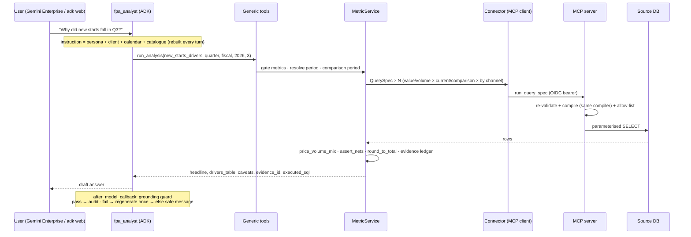

# Architecture

## Design rules (carried over from the Kaplan build, now enforced generically)

1. **The model classifies intent and picks a tool. Code does everything else.** Reviewed code
   compiles every headline query, performs every calculation and computes every date.
2. **The semantic layer is the only source of meaning.** A figure exists only if a metric row
   defines it; the agent's knowledge, vocabulary and persona are assembled from the catalogue.
3. **Every number is evidenced.** Each tool result carries an `evidence_id`; the grounding guard
   blocks any answer number it cannot attribute to evidence from this turn.
4. **Drivers net exactly.** Every decomposition is an algebraic identity proved in `Decimal`
   (`assert_nets`) before it is shown; display rounding preserves the sum.
5. **Read-only, least privilege.** Sources are reached through a read-only MCP server with an
   allow-list, bound parameters and OIDC caller identity; secrets live in Secret Manager.

## Request flow

## Components

### Semantic layer (`fpa_agent/semantic`)
* `models.py` — typed rows for the eight tables (see [SEMANTIC_LAYER.md](SEMANTIC_LAYER.md)).
* `repository.py` — BigQuery (prod) or YAML (dev/test) backend; 10-second TTL cache so edits
  are live on the next question without redeploying (Agent Engine gives no restart control);
  on reload failure the last good catalogue keeps serving.
* `search.py` — deterministic term resolution (id → term → alias → phrase → token overlap →
  fuzzy), optional closed-set LLM fallback that can only return existing ids.
* `validator.py` — static lint + live schema check (`fpa validate --live`).
* `loader.py` / `schema.py` — YAML ⇄ BigQuery ⇄ Excel, DDL generation, change log.

### Query compiler (`fpa_agent/query/compiler.py`)
Turns a metric row + period + filters + breakdown into a `QuerySpec` and then SQL:
`SELECT [period bucket,] [dims,] <measure> FROM <table> [JOIN ...] WHERE <time> AND <filters> [GROUP BY]`.
Time patterns: `date`, `year_month`, `period_key` (`YYYYMM`/`YYYY_MM`/`YYYY-MM`), `fiscal_year`,
`none`; `snapshot` metrics read the period's last month. Dialects: sqlite, mssql, postgres,
redshift, oracle, snowflake, bigquery, mysql (paramstyle, month bucketing, LIMIT syntax).
Expressions are tokenised against an allow-list; statement keywords, comments and separators are
rejected; all values are bound.

### Engine (`fpa_agent/engine`)
* `primitives.py` — `delta`, `contribution`, `price_volume`, `mix_rate`, `price_volume_mix`,
  `ratio_bridge`, `rollforward_bridge`; each self-verifies netting. Edge cases learned in
  production are built in: zero-volume and excluded categories become an explicit
  `unattributed` driver; non-additive breakdowns get a named `non_additive_overlap` driver;
  roll-forwards net against an independently fetched ending level with an `other_flows` gap.
* `formulas.py` — AST-whitelisted Decimal evaluation of derived metrics.
* `methods.py` — method registry: required roles, dimension need, supported comparisons. A new
  decomposition shape is one registered function; every client with that shape is then config.
* `service.py` — `MetricService`: governance gates (confirmed / partial / incomplete / blocked /
  causal), period + comparison resolution (prior year, prior period, budget), concurrent
  fetches, post-netting adjustments, display rounding that preserves sums, evidence records.

### Grounding (`fpa_agent/grounding`)
* `evidence.py` — `Evidence` records (definition hash, source, period, executed SQL, values,
  upstream evidence ids) and lineage traversal.
* `guard.py` — pure checks: numbers (exact, honest rounding, K/M/B scaling, ratio→%, sum/
  difference of two grounded numbers), table-row labels against tool-returned categories (header
  keywords come from the client's dimensions), exploratory figures must be labelled, no "no data"
  claims after data came back; attribution of every number to evidence ids.
* `callbacks.py` — ADK wiring with per-call state keys (no race when tools run concurrently),
  2-turn allow-list window, one constrained regeneration, safe message fallback, JSONL/GCS audit
  record per turn (answer, outcome, number → evidence map, evidence bodies).

### Agents (`fpa_agent/agents`)
* `fpa_analyst` — root, temperature 0.1, tools: `search_semantic_layer`, `get_definition`,
  `get_metric`, `compare_metric`, `run_analysis`, `list_dimension_values`, `calculate`,
  `explain_lineage`, `data_explorer` (AgentTool).
* `data_explorer` — read-only `describe_tables` / `run_exploratory_sql` on allow-listed tables;
  everything it returns is flagged exploratory and must be labelled as such.
* `prompts.py` — instruction = persona (sl_agent_profiles) + client profile + code-computed
  calendar facts + catalogue tables + generic procedure + non-overridable grounding rules.

### MCP server (`mcp_server/`)
One image for every database. Tools: `run_query_spec` (re-compiles the structured spec server-
side), `run_readonly_sql` (exploration), `run_reference_sql` (reconciliation), `describe_schema`,
`ping`. OIDC middleware verifies Google-signed ID tokens (audience + caller email).

## Why it stays fast
Kaplan's dedicated tools existed to avoid 4-hop agent chains. The template keeps that property
generically: a governed number is **one** tool call from the root agent; inside that call the
service fetches all inputs concurrently (`asyncio.gather`) over a direct MCP client session.

## Extending
| Need | Change |
|---|---|
| New metric / alias / filter / definition fix | catalogue row |
| New recurring "why" question with an existing shape | analysis row |
| New source system | sources row + deploy `mcp_server` with env |
| New dialect | `_month_bucket`, paramstyle, limit in `compiler.py` |
| New decomposition shape | one function + `register()` in `methods.py` (+ primitive if new math) |
